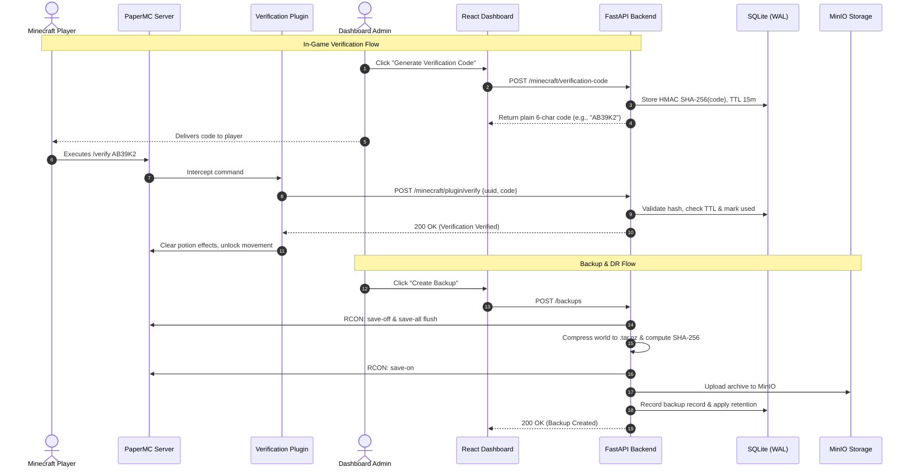

# System Architecture & Technical Design

This document details the architecture, design choices, data flows, and security model of the Cloud Minecraft Management Platform.

---

## 1. High-Level Architecture

The platform follows a modular, decoupled microservice pattern managed via Docker Compose. The architecture is composed of six distinct subsystems:

1. **Client Tier**: Web dashboard written in React 19 + TypeScript + Vite, served by Nginx in production with Firebase Client SDK integration.
2. **API & Control Plane**: FastAPI async web server coordinating container lifecycles, RCON command dispatch, background scheduling, RBAC verification, and REST endpoints.
3. **Database Tier**: Embedded SQLite3 database configured with Write-Ahead Logging (WAL) and automated forward schema migrations.
4. **Game Server Workload**: High-performance PaperMC container (`itzg/minecraft-server`) running Java 21 with a custom verification plugin.
5. **Object Storage Tier**: MinIO S3-compatible object storage configured with dedicated bucket policies and automated retention enforcement.
6. **Docker Security Layer**: Docker Socket Proxy granting restricted, read-write access to container management primitives without exposing the root Docker daemon.

```mermaid
graph TD
    User([Dashboard Operator]) -->|HTTPS| Frontend[Nginx / React 19 Frontend]
    Frontend -->|REST API / Bearer Token| Backend[FastAPI Backend :8000]
    
    Backend -->|SQL Queries (WAL)| DB[(SQLite3 Database)]
    Backend -->|S3 API (boto3)| MinIO[(MinIO Object Storage :9000)]
    Backend -->|RCON TCP :25575| Minecraft[PaperMC Server :25565]
    Backend -->|Restricted API| DockerProxy[Docker Socket Proxy :2375]
    DockerProxy -->|Control Socket| DockerDaemon[(Host Docker Daemon)]
    
    MCPlayer([Minecraft Player]) -->|TCP :25565| Minecraft
    MinecraftPlugin[Paper Verification Plugin] -.->|HTTP REST| Backend
```

---

## 2. Core Subsystems & Component Breakdown

### 2.1 Backend Control Plane (FastAPI)
- **Framework**: FastAPI with asynchronous route handlers and Starlette middleware.
- **Security & Authorization**:
  - `auth.py`: Decodes and verifies Firebase JWT tokens; provides deterministic development mock token support for headless testing.
  - `permissions.py`: Evaluates a 3-tier Role-Based Access Control matrix (`Administrator`, `Operator`, `User`).
  - `slowapi`: Protects sensitive endpoints (verification code generation, RCON dispatch) against brute force and DDoS.
- **Container Management**: `backend/services/docker_service.py` connects via Docker SDK or Docker Socket Proxy to check container statuses, inspect resource utilization, and stream console logs safely.
- **RCON Client**: `backend/services/rcon_service.py` wraps `mcrcon` with socket timeout safeguards, reconnection policies, and command sanitization.

### 2.2 Database Layer & Schema Migrations
The platform utilizes an embedded SQLite3 database running with:
- `PRAGMA journal_mode=WAL;` for concurrency between reading threads and transactional writes.
- `PRAGMA synchronous=NORMAL;` for optimal I/O throughput.
- `PRAGMA foreign_keys=ON;` for relational integrity.

#### Schema Versioning Matrix:
- **v1**: Migration tracking table `schema_version`.
- **v2**: `users` (UID, email, role, created_at, last_login) and `audit_logs` (actor_uid, action, target_type, target_id, details, ip_address, timestamp).
- **v3**: `minecraft_links` (user_id, player_uuid, player_name, linked_at) and `verification_sessions` (code_hash, player_uuid, player_name, expires_at, used).
- **v4**: `backups` (id, filename, s3_key, file_size, sha256, trigger_type, created_at).
- **v5**: `server_metrics` (id, timestamp, cpu_percent, memory_mb, memory_percent, disk_percent, online_players, container_status) with indexing on `timestamp`.
- **v6**: `alerts` (id, alert_type, message, severity, status, created_at, acknowledged_at, resolved_at).

### 2.3 Object Storage & Backup Engine
- **Storage Subsystem**: S3-compliant MinIO instance with dedicated health probes.
- **Backup Process**:
  1. Issues RCON commands `save-off` and `save-all flush` to ensure all world chunks are committed to disk.
  2. Creates a gzip-compressed archive (`.tar.gz`) of the Minecraft world directory.
  3. Re-enables world auto-saving via RCON `save-on`.
  4. Computes streaming SHA-256 hash for integrity validation.
  5. Streams the archive to MinIO S3 (`backups/` prefix).
  6. Records metadata into SQLite `backups` table and prunes old backups per `BACKUP_RETENTION_COUNT`.
- **Restoration Process**:
  1. Verifies SHA-256 against stored checksum.
  2. Inspects archive members to prevent tar path-traversal attacks (`..` or absolute paths).
  3. Stops the Minecraft server container.
  4. Replaces world files cleanly.
  5. Restarts the Minecraft server container.

### 2.4 Monitoring & Telemetry Pipeline
- **Collector Loop**: An APScheduler background task polls system metrics every interval:
  - System CPU percentage via `psutil`.
  - Process and system RAM utilization in megabytes and percentage.
  - Disk storage utilization on the game volume.
  - Live player counts querying Minecraft via RCON.
  - Docker container state (`running`, `exited`, `restarting`).
- **Alerting Engine**: `monitoring/alerts.py` continuously compares metric points against thresholds (`CPU > 85%`, `Memory > 90%`, `Disk > 90%`). Unacknowledged alerts trigger notifications and persist in the database.

### 2.5 Minecraft Verification Plugin
- **Technology**: Java 21 PaperMC API.
- **Flow**:
  1. When an unverified player joins, the plugin applies blindness and slowness, immobilizes movement, and suppresses chat / block interaction.
  2. The player types `/verify <code>`.
  3. The plugin dispatches a POST request to the backend `/minecraft/plugin/verify`.
  4. The backend verifies the HMAC SHA-256 code against active verification sessions.
  5. Upon approval, player restrictions are lifted instantly, and account linking is completed in SQLite.

---

## 3. Data Flow Diagram



---

## 4. Disaster Recovery & High Availability Posture

1. **Crash Recovery**: SQLite WAL mode ensures transactional recovery without database corruption across sudden process termination.
2. **Stateless Backend**: The FastAPI backend contains zero in-memory state; container restarts restore all operational states immediately from SQLite and Docker status.
3. **Immutable Archives**: S3 backup objects are timestamped and cryptographically verified using SHA-256. Restores will abort immediately if archive integrity fails.
4. **Graceful RCON Degradation**: If the Minecraft server is unreachable via RCON during a backup, the backup engine captures a consistent filesystem snapshot while logging an alert without crashing the management process.
